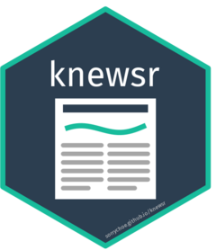

<!-- README.ko.md is generated from README.ko.Rmd. Please edit that file -->

```{r, include = FALSE}
knitr::opts_chunk$set(collapse = TRUE, comment = "#>")
```

# knewsr <a href="https://sorrychoe.github.io/knewsr/"></a>

[English](https://github.com/sorrychoe/knewsr/blob/release/README.md)

knewsr는 한국어 뉴스 데이터의 수집과 전처리를 자동화하고, 빈도·TF-IDF·DTM·공기어·키니스·기간별 추이 같은
기초 텍스트 분석을 몇 줄의 R 코드로 끝내는 패키지입니다.
Excel·CSV·JSON 파일(BigKinds 내보내기 포함), 제목·본문 컬럼이 있는 어떤 data.frame,
네이버 뉴스 검색 API, RSS/Atom 피드를 모두 같은 파이프라인에 넣을 수 있습니다.

## 설치

아직 CRAN에 배포되지 않았습니다.

``` r
devtools::install_github("sorrychoe/knewsr")
```

`tokenize_ko()`는 기본적으로 `keyword` 컬럼(BigKinds 내보내기의 `키워드` 등)을 나누므로
형태소 분석기가 필요 없습니다. 네이버나 RSS로 수집한 데이터처럼 키워드 컬럼이 없으면 제목이나 본문을
분석해야 하며(`field = "title"` 또는 `"text"`), 이때는 시스템 MeCab-ko, mecab-ko-dic과 `RcppMeCab`
패키지가 필요합니다.
JSON 파일은 `jsonlite`, 네이버 수집은 `httr2`, RSS 수집은 `xml2`가 필요합니다.
네이버 API 키는 `NAVER_CLIENT_ID`, `NAVER_CLIENT_SECRET` 환경변수로 설정합니다.

## 사용법

```{r}
library(knewsr)

news <- as_news(president_lee_2026_08) |> clean_news()
# 또는 read_news("folder/"), collect_naver("검색어"), collect_rss("https://.../rss")
tokens <- tokenize_ko(news, keep = "source")

count_terms(tokens)
keyness(tokens, group = "source", target = "조선일보")
```

| 단계 | 함수 |
|---|---|
| 입력 | `read_news()`, `read_bigkinds()`, `as_news()` |
| 수집 | `collect_naver()`, `collect_rss()` |
| 전처리 | `clean_news()`, `tokenize_ko()`, `ngrams_ko()`, `stopwords_ko()` |
| 분석 | `count_terms()`, `tf_idf()`, `as_dtm()`, `as_tdm()`, `cooccurrence()`, `keyness()`, `term_trend()`, `summarise_corpus()` |
| 시각화 | `plot_terms()`, `plot_keyness()`, `plot_trend()`, `plot_wordcloud()`, `plot_network()` |

자세한 흐름은 `vignette("getting-started", package = "knewsr")`를 참고하세요.

## 라이선스

[MIT](https://choosealicense.com/licenses/mit/)

## 문의

사용 중 문제 발생 시 [GitHub 이슈](https://github.com/sorrychoe/knewsr/issues)에 등록해주세요.
