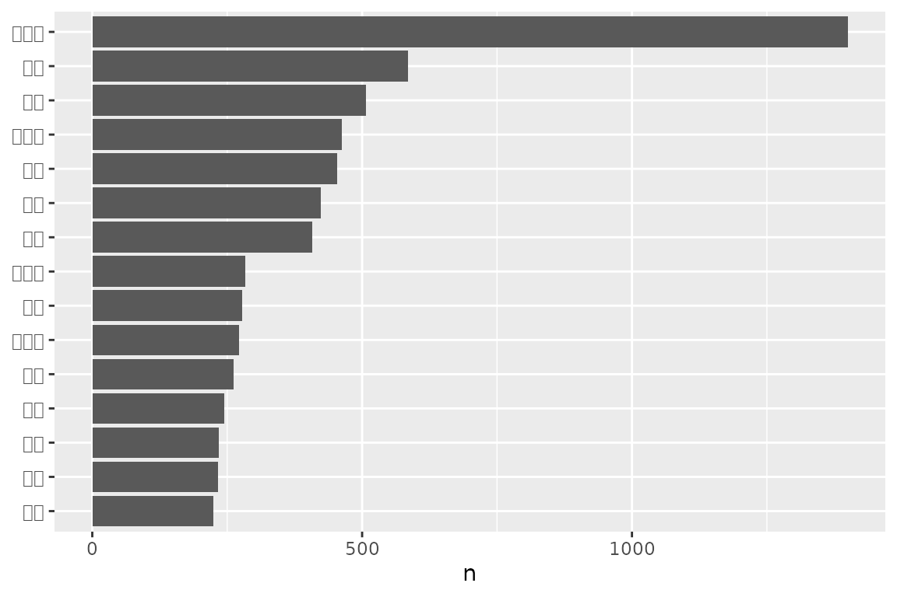
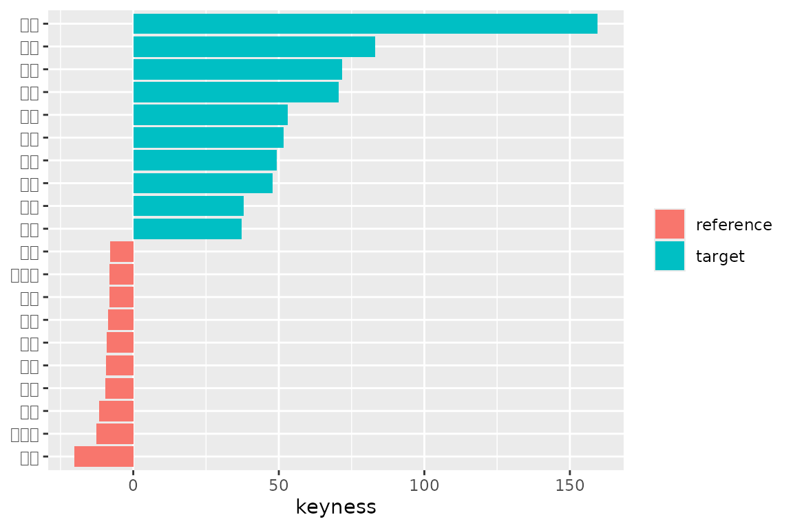
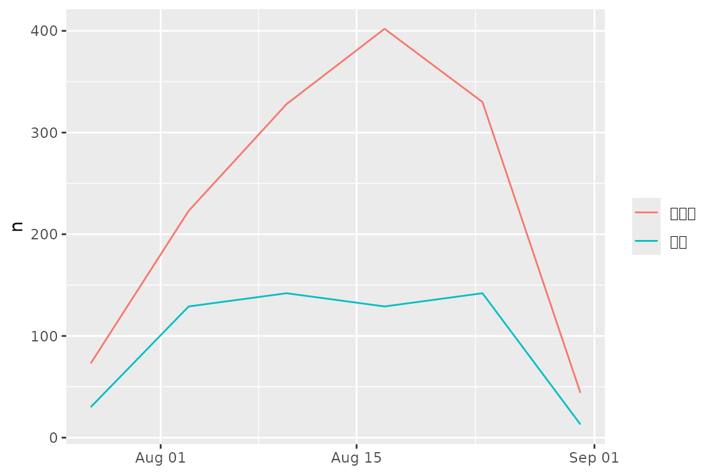

# Getting started with knewsr

knewsr는 한국어 뉴스 데이터를 **표준 스키마 → 전처리 → 토큰 테이블 →
기초 통계** 순서로 다룹니다. 모든 결과는 tibble 또는 sparse
matrix입니다.

``` r

library(knewsr)
```

## 1. 읽기

모든 입력은 표준 스키마(`doc_id`, `date`, `source`, `title`, `text`,
`keyword`)로 바뀝니다.

파일은
[`read_news()`](https://sorrychoe.github.io/knewsr/reference/read_news.md)로
읽습니다. Excel, CSV/TSV(UTF-8, CP949), JSON, JSONL을 받고, 폴더를 주면
안의 파일을 모두 읽어 합칩니다. BigKinds 내보내기도 같은 함수로
읽습니다.

``` r

path <- system.file("extdata", "bigkinds_sample.xlsx", package = "knewsr")
read_news(path)
#> Detected columns: date <- `일자`, source <- `언론사`, title <- `제목`, keyword
#> <- `키워드`
#> # A tibble: 31 × 6
#>    doc_id date       source   title                                text  keyword
#>    <chr>  <date>     <chr>    <chr>                                <chr> <chr>  
#>  1 1      2020-01-31 경향신문 "[사설] 한반도 긴장 높인 북한의 군사정찰위성 발사 규탄한다"… NA    한반도,긴장…
#>  2 2      2020-01-30 한겨레   "허리에 '캡사이신' 찬 경찰 민주노총, 6시간 만에 자진해산"… NA    허리,캡사이…
#>  3 3      2020-01-29 조선일보 "윤 대통령 ‘외국인 가사도우미’ 이어 돌봄 보육도 “시장화”"… NA    대통령,외국…
#>  4 4      2020-01-28 중앙일보 "윤 대통령, 스가 전 총리 만나 “한일 관계, 완전한 복원” … NA    대통령,스가…
#>  5 5      2020-01-27 동아일보 "‘직권남용죄’ 남용 유감"             NA    직권남용죄,…
#>  6 6      2020-01-26 경향신문 "‘외국인 가사도우미’ 검토하라는 대통령 희생 강요받는 노동"…… NA    외국인,가사…
#>  7 7      2020-01-25 경향신문 "“한상혁 면직 언론장악 시도” 민주 방송법 개정으로 맞대응"…… NA    한상혁,면직…
#>  8 8      2020-01-24 한겨레   "[사설] 한상혁 위원장 면직, 방송 장악 신호탄인가"…… NA    면직,한상혁…
#>  9 9      2020-01-23 한겨레   "한 총리 \"시찰단 브리핑, 방류절차 투명성 보였다 매우 만족… NA    브리핑,총리…
#> 10 10     2020-01-22 한겨레   "한국이 올인하는 인 태 전략은 안녕한가? [정의길의 세계, 그… NA    한국,올인,…
#> # ℹ 21 more rows
```

이미 메모리에 있는 data.frame은
[`as_news()`](https://sorrychoe.github.io/knewsr/reference/as_news.md)로
바꿉니다. 흔한 컬럼명(`headline`, `body`, `content`, `pubDate`, `press`
등)은 자동으로 찾고, 찾은 결과를 메시지로 알려 줍니다. 자동 인식이
틀리면 `text = "본문열"`처럼 직접 지정합니다.

``` r

other <- data.frame(headline = "정부, 예산안 발표", body = "정부가 내년 예산안을 발표했다.",
                    pubDate = "2024.01.02", press = "A일보")
as_news(other)
#> Detected columns: date <- `pubDate`, source <- `press`, title <- `headline`,
#> text <- `body`
#> # A tibble: 1 × 6
#>   doc_id date       source title             text                        keyword
#>   <chr>  <date>     <chr>  <chr>             <chr>                       <chr>  
#> 1 1      2024-01-02 A일보  정부, 예산안 발표 정부가 내년 예산안을 발표했다.…… NA

news <- as_news(president_lee_2026_08)
#> Detected columns: doc_id <- `뉴스 식별자`, date <- `일자`, source <- `언론사`,
#> title <- `제목`, keyword <- `키워드`
news
#> # A tibble: 300 × 6
#>    doc_id                     date       source   title            text  keyword
#>    <chr>                      <date>     <chr>    <chr>            <chr> <chr>  
#>  1 01101001.20260831191916001 2026-08-31 한겨레   "이토록 뜨거운데, 바뀌지 … NA    뉴스룸,이승…
#>  2 01101101.20260831163230001 2026-08-31 한국일보 "\"외부 조문 사양\"에도… NA    사양,외부,…
#>  3 01100701.20260831142845001 2026-08-31 세계일보 "오세훈 “李대통령 부동산 … NA    오세훈,대통…
#>  4 01100501.20260831111921003 2026-08-31 문화일보 "與 전은수 “국힘, 발목잡… NA    국힘,전은수…
#>  5 01100701.20260831100115001 2026-08-31 세계일보 "국토장관 후보자 \"용산공… NA    용산공원,국…
#>  6 01100501.20260831070524001 2026-08-31 문화일보 "용혜인 지명에 “꼴페미 정… NA    용혜인,지명…
#>  7 01101101.20260831001113001 2026-08-31 한국일보 "[사설] 지지율 하락 속 … NA    지지율,하락…
#>  8 01100801.20260830233831001 2026-08-30 조선일보 "[태평로] 국보법 위반해도… NA    국보법,위반…
#>  9 01100501.20260830224353001 2026-08-30 문화일보 "김승원 법무장관 후보자 “… NA    대전환,김승…
#> 10 01100101.20260830205932001 2026-08-30 경향신문 "“이용자 적어 없앤다니 취… NA    이용자,취약…
#> # ℹ 290 more rows
```

## 1-1. 수집

네이버 뉴스 검색 API(제목·요약·날짜·링크)와 RSS/Atom 피드에서 바로
수집할 수 있습니다.

``` r

# NAVER_CLIENT_ID, NAVER_CLIENT_SECRET 환경변수 필요
naver <- collect_naver("기준금리", n = 300)
```

``` r

collect_rss(system.file("extdata", "sample_rss.xml", package = "knewsr"))
#> # A tibble: 5 × 8
#>   doc_id                       date       source title text  keyword feed  link 
#>   <chr>                        <date>     <chr>  <chr> <chr> <chr>   <chr> <chr>
#> 1 https://www.yna.co.kr/view/… 2026-11-14 연합뉴스 … "메타엠… NA    NA      /hom… http…
#> 2 https://www.yna.co.kr/view/… 2026-11-14 연합뉴스 … "美교통… NA    NA      /hom… http…
#> 3 https://www.yna.co.kr/view/… 2026-11-14 연합뉴스 … "모레노… NA    NA      /hom… http…
#> 4 https://www.yna.co.kr/view/… 2026-11-14 연합뉴스 … "이탈리… NA    NA      /hom… http…
#> 5 https://www.yna.co.kr/view/… 2026-11-14 연합뉴스 … "한국 … NA    NA      /hom… http…
```

## 2. 전처리

[`clean_news()`](https://sorrychoe.github.io/knewsr/reference/clean_news.md)는
말머리(`[속보]`), 기자 바이라인, 이메일, URL, 특수문자를 지웁니다.

``` r

news <- clean_news(news)
summarise_corpus(news, by = "source")
#> # A tibble: 10 × 4
#>    source       n first_date last_date 
#>    <chr>    <int> <date>     <date>    
#>  1 세계일보    48 2026-08-02 2026-08-31
#>  2 한국일보    38 2026-08-01 2026-08-31
#>  3 한겨레      35 2026-08-02 2026-08-31
#>  4 문화일보    34 2026-08-01 2026-08-31
#>  5 중앙일보    30 2026-08-02 2026-08-30
#>  6 경향신문    29 2026-08-03 2026-08-30
#>  7 서울신문    23 2026-08-02 2026-08-28
#>  8 동아일보    22 2026-08-01 2026-08-26
#>  9 조선일보    21 2026-08-05 2026-08-30
#> 10 국민일보    20 2026-08-01 2026-08-30
```

## 3. 토큰화

기본값은 BigKinds `keyword` 컬럼을 쓰는 것이라 형태소 분석기가 필요
없습니다. `keep`으로 지정한 컬럼은 토큰 테이블에 함께 붙습니다.

``` r

tokens <- tokenize_ko(news, keep = "source")
tokens
#> # A tibble: 63,945 × 3
#>    doc_id                     source token       
#>    <chr>                      <chr>  <chr>       
#>  1 01101001.20260831191916001 한겨레 뉴스룸      
#>  2 01101001.20260831191916001 한겨레 이승준      
#>  3 01101001.20260831191916001 한겨레 정치데스크  
#>  4 01101001.20260831191916001 한겨레 전쟁        
#>  5 01101001.20260831191916001 한겨레 17          
#>  6 01101001.20260831191916001 한겨레 전당대회    
#>  7 01101001.20260831191916001 한겨레 더불어민주당
#>  8 01101001.20260831191916001 한겨레 전당        
#>  9 01101001.20260831191916001 한겨레 대회        
#> 10 01101001.20260831191916001 한겨레 가지        
#> # ℹ 63,935 more rows
```

본문을 직접 분석하려면 시스템에 MeCab-ko와 mecab-ko-dic을 설치하고
`RcppMeCab` 패키지를 설치합니다.

``` r

options(knewsr.mecab_dic = "/usr/lib/x86_64-linux-gnu/mecab/dic/mecab-ko-dic")
tokenize_ko(news, field = "text", pos = "noun")
```

## 4. 기초 분석

``` r

count_terms(tokens)
#> # A tibble: 10,098 × 2
#>    token      n
#>    <chr>  <int>
#>  1 대통령  1400
#>  2 정부     585
#>  3 후보     507
#>  4 이재명   463
#>  5 대표     454
#>  6 의원     423
#>  7 국민     407
#>  8 민주당   283
#>  9 정책     278
#> 10 청와대   272
#> # ℹ 10,088 more rows
count_terms(tokens, by = "source", by_doc = TRUE)
#> # A tibble: 23,334 × 3
#>    source   token      n
#>    <chr>    <chr>  <int>
#>  1 세계일보 이재명    46
#>  2 세계일보 대통령    43
#>  3 한국일보 이재명    38
#>  4 한국일보 대통령    36
#>  5 문화일보 이재명    34
#>  6 세계일보 정부      34
#>  7 한겨레   이재명    34
#>  8 한겨레   대통령    32
#>  9 경향신문 이재명    29
#> 10 중앙일보 이재명    29
#> # ℹ 23,324 more rows
tf_idf(tokens, by = "source")
#> # A tibble: 23,334 × 6
#>    source   token        n      tf   idf  tf_idf
#>    <chr>    <chr>    <int>   <dbl> <dbl>   <dbl>
#>  1 조선일보 장씨        30 0.00668  2.30 0.0154 
#>  2 서울신문 하우스      15 0.00281  2.30 0.00647
#>  3 경향신문 정지        15 0.00270  2.30 0.00621
#>  4 동아일보 요금        12 0.00251  2.30 0.00578
#>  5 문화일보 병역        15 0.00236  2.30 0.00544
#>  6 서울신문 버스        24 0.00450  1.20 0.00542
#>  7 동아일보 전술        11 0.00230  2.30 0.00530
#>  8 서울신문 딥페이크    11 0.00206  2.30 0.00475
#>  9 국민일보 토허구역     8 0.00190  2.30 0.00437
#> 10 동아일보 채점         9 0.00188  2.30 0.00433
#> # ℹ 23,324 more rows
ngrams_ko(news, n = 2)
#> # A tibble: 63,645 × 2
#>    doc_id                     token                
#>    <chr>                      <chr>                
#>  1 01101001.20260831191916001 뉴스룸 이승준        
#>  2 01101001.20260831191916001 이승준 정치데스크    
#>  3 01101001.20260831191916001 정치데스크 전쟁      
#>  4 01101001.20260831191916001 전쟁 17              
#>  5 01101001.20260831191916001 17 전당대회          
#>  6 01101001.20260831191916001 전당대회 더불어민주당
#>  7 01101001.20260831191916001 더불어민주당 전당    
#>  8 01101001.20260831191916001 전당 대회            
#>  9 01101001.20260831191916001 대회 가지            
#> 10 01101001.20260831191916001 가지 장면            
#> # ℹ 63,635 more rows
```

문서-단어 행렬과 공기어:

``` r

dtm <- as_dtm(tokens, weight = "tfidf")
dim(dtm)
#> [1]   300 10098
cooccurrence(tokens, top_n = 30)
#> # A tibble: 435 × 3
#>    term1        term2      n
#>    <chr>        <chr>  <dbl>
#>  1 대통령       이재명   270
#>  2 이재명       정부     186
#>  3 대통령       정부     165
#>  4 국민         이재명   150
#>  5 국민         대통령   143
#>  6 이재명       청와대   112
#>  7 강조         이재명   111
#>  8 대통령       청와대   111
#>  9 이재명       추진     108
#> 10 더불어민주당 이재명   103
#> # ℹ 425 more rows
cooccurrence(tokens, window = 2, top_n = 30)
#> # A tibble: 331 × 3
#>    term1  term2      n
#>    <chr>  <chr>  <dbl>
#>  1 대통령 이재명   328
#>  2 이재명 정부      95
#>  3 대통령 청와대    60
#>  4 부동산 정책      46
#>  5 민주당 의원      41
#>  6 대통령 대표      39
#>  7 대통령 민주당    39
#>  8 국민   대통령    36
#>  9 서울   시장      36
#> 10 대통령 의원      36
#> # ℹ 321 more rows
```

집단 비교(키니스)와 기간별 추이:

``` r

k <- keyness(tokens, group = "source", target = "조선일보")
head(k)
#> # A tibble: 6 × 5
#>   token n_target n_reference keyness        p
#>   <chr>    <int>       <int>   <dbl>    <dbl>
#> 1 장씨        30           0   160.  1.41e-36
#> 2 실종        26          17    83.0 8.16e-20
#> 3 발견        20           9    71.7 2.49e-17
#> 4 경장        17           4    70.5 4.60e-17
#> 5 한미        24          35    53.0 3.41e-13
#> 6 시신        11           1    51.7 6.39e-13
trend <- term_trend(tokens, news, terms = c("대통령", "정부"), unit = "week")
trend
#> # A tibble: 12 × 3
#>    date       token      n
#>    <date>     <chr>  <int>
#>  1 2026-07-27 대통령    73
#>  2 2026-07-27 정부      30
#>  3 2026-08-03 대통령   223
#>  4 2026-08-03 정부     129
#>  5 2026-08-10 대통령   328
#>  6 2026-08-10 정부     142
#>  7 2026-08-17 대통령   402
#>  8 2026-08-17 정부     129
#>  9 2026-08-24 대통령   330
#> 10 2026-08-24 정부     142
#> 11 2026-08-31 대통령    44
#> 12 2026-08-31 정부      13
```

## 5. 시각화

시각화 함수는 ggplot 객체를 반환합니다. 한글 글꼴은
`+ ggplot2::theme(text = ggplot2::element_text(family = "NanumGothic"))`처럼
지정합니다.

``` r

plot_terms(count_terms(tokens), top_n = 15)
```



``` r

plot_keyness(k, top_n = 10)
```



``` r

plot_trend(trend)
```



[`plot_wordcloud()`](https://sorrychoe.github.io/knewsr/reference/plot_helpers.md)(ggwordcloud)와
[`plot_network()`](https://sorrychoe.github.io/knewsr/reference/plot_helpers.md)(ggraph,
igraph)는 해당 패키지가 설치된 경우에 사용할 수 있습니다.
